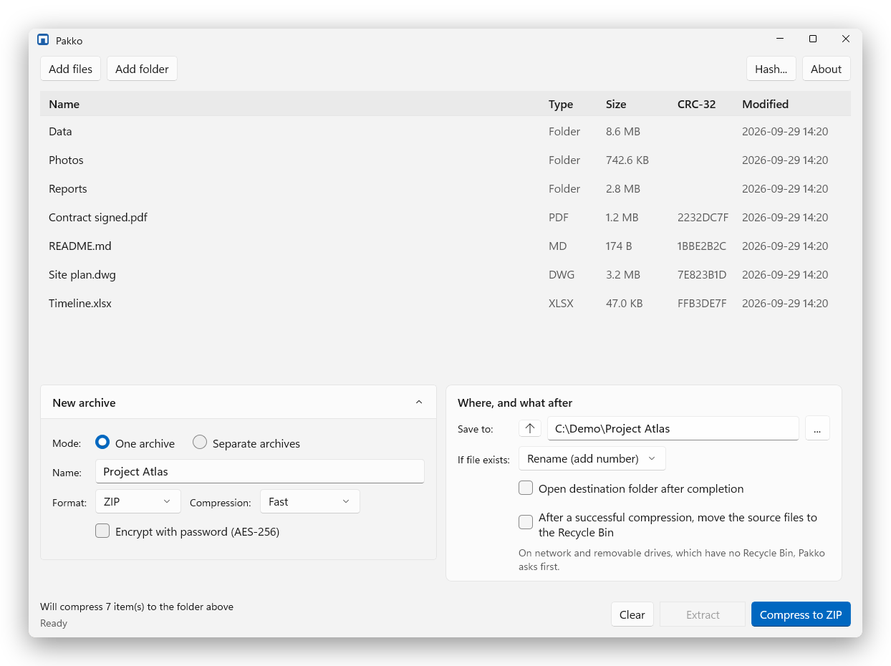
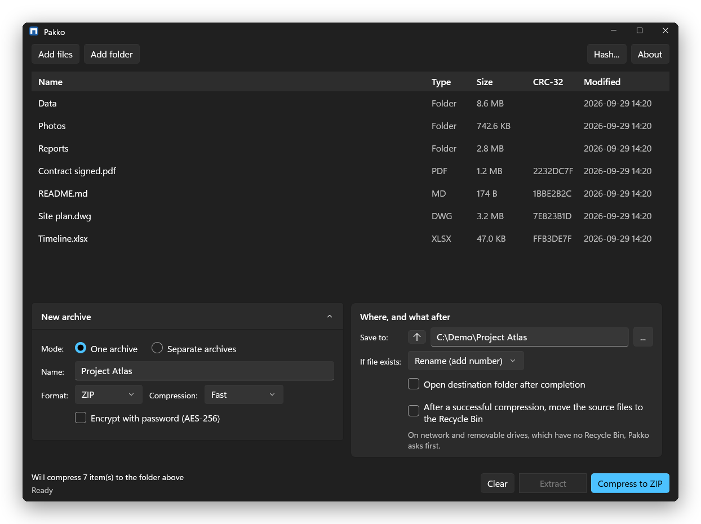
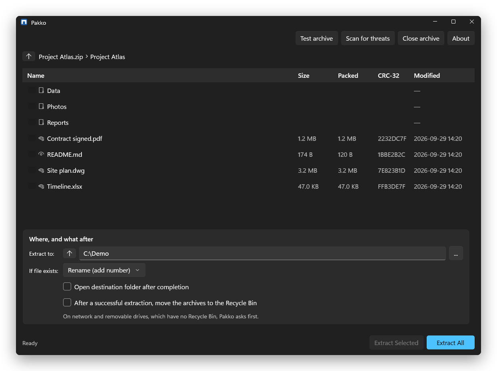

  

<h1 align="center">Pakko — Windows Archiver</h1>

ZIP through .NET's own <code>System.IO.Compression</code>; tar, 7z, RAR and the rest through Windows' own <code>tar.exe</code>, in a sandbox.

<strong>No 7-Zip. No WinRAR. No third-party compression code.</strong>

  
  
  
  
  

  <a href="https://pakkoapp-oss.github.io/pakko/">🌐 Project website</a> ·
  <a href="https://apps.microsoft.com/detail/9p5mw010d8pr">🛒 Get it from Microsoft Store</a> ·
  <a href="https://github.com/microsoft/winget-pkgs/pull/449503">⌨️ <code>pakko</code> command line on winget (in review)</a> ·
  <a href="https://ko-fi.com/pakko_app">☕ Support the project on Ko-fi</a> ·
  <a href="README.uk.md">🇺🇦 Українською</a>

---

## Install

The app needs Windows 10 version 2004 (build 19041) or later, or Windows 11, x64 or ARM64. The
standalone `pakko` zip has been tested on Windows 10 22H2, Windows 11 and Windows Server 2022.

- **Microsoft Store** (recommended): https://apps.microsoft.com/detail/9p5mw010d8pr, or
  `winget install 9P5MW010D8PR --source msstore`. Updates come through the Store, and the install
  also gives the `pakko` command in any terminal.
- **GitHub Releases**: every version tag publishes the MSIX and a standalone `pakko` command-line
  zip per architecture, with a `SHA256SUMS` file, a component list (SBOM) and build attestations:
  [releases](https://github.com/pakkoapp-oss/pakko/releases). The MSIX is signed with the
  project's own development certificate, which you add to Windows' trusted certificates before
  installing ([`scripts/README.md`](scripts/README.md); a publicly trusted certificate is planned,
  see [`docs/SIGNING.md`](docs/SIGNING.md)).
- **winget (command line only)**: the `pakko` zip is submitted to the winget catalog as
  `PavloRybchenko.PakkoCLI` ([pull request](https://github.com/microsoft/winget-pkgs/pull/449503)) and waits for a moderator; once it is
  accepted, `winget install PavloRybchenko.PakkoCLI`. Until then use the zip from GitHub Releases. See [`docs/CLI.md`](docs/CLI.md),
  "Distribution".

---

## What It Does

### Formats

| Format | Status | Through |
|--------|--------|---------|
| ZIP | ✅ read and create | `System.IO.Compression` (.NET) |
| Password-protected ZIP | ✅ read (ZipCrypto, WinZip AES) and create (AES-256 only; file names inside stay visible) | `System.IO.Compression` + .NET cryptography |
| tar, tar.gz, tar.bz2, tar.xz, tar.zst, tar.lzma | ✅ read and create; single `.gz`/`.bz2`/`.xz` files too (v1.9.0) | `tar.exe` |
| 7z | ✅ read; create without a password, where `tar.exe` has the 7z writer | `tar.exe` |
| RAR | ✅ read only — libarchive has no RAR writer | `tar.exe` |
| Encrypted 7z/RAR | ❌ recognized and refused with a clear message | — |
| ISO 9660, CAB, cpio, ar (`.deb`), `.Z`, lzip | Since v1.10.0: read only, where the installed `tar.exe` reads each; a UDF image (most Windows install ISOs) refused with the reason | `tar.exe` |

`tar.exe` is part of Windows, and which formats it reads depends on the Windows build. A current
Windows 11 reads all of the above; the `tar.exe` of Windows 10 is built with zlib only and reads
tar and tar.gz. Pakko asks the installed `tar.exe` and offers only what it can do (`pakko i`
lists it). Reading runs inside an AppContainer sandbox with no network access.

### In Explorer

- **Context menu** — Open, Extract here, Extract to folder, Add to `X.zip` / `X.7z` / `X.tar`,
  Compress…, Test archive, Scan for threats, Hash (CRC-32, SHA-256); in the Windows 11 menu and
  under "Show more options". Each command runs in a Pakko window with progress, a password prompt
  and a conflict dialog.
- **File types** — double-clicking any archive Pakko reads opens it in the Archive Browser.
- **Mark of the Web** — files extracted from a downloaded archive keep its `Zone.Identifier` by
  default, so Office opens an extracted document in Protected View instead of running its macros,
  and SmartScreen still warns before an extracted program runs (7-Zip does not do this by
  default). You may leave it off for one trusted archive, unless Group Policy decides.

### In the app

- **Archive** — one archive or one per item, ZIP, 7z or any tar format, with a compression level.
- **Extract** — smart folder logic, Ask / Overwrite / Rename / Skip per conflict; the dates stored
  in the archive are kept.
- **Archive Browser** — browse an archive's folders, extract a selection or everything, preview an
  image or text file without extracting by hand, climb past the archive root into the real
  filesystem.
- **Test** — for every format: 7z, tar.bz2, tar.xz and tar.zst written with a check have their
  contents verified; tar, tar.gz, tar.lzma and RAR get a structure check that says so.
- **Scan for threats** — the archive's contents go to the installed antivirus through Windows' AMSI,
  password-protected ZIP entries included.
- **Recovery data (PAR2)** — standard PAR 2.0 files next to a new archive (5, 10 or 20 %); verify and
  repair into a new file. par2cmdline and MultiPar read Pakko's sets, and Pakko reads theirs.
- System tray icon, 37 languages (follows the Windows language, English otherwise), a file log at
  `%LocalAppData%\Pakko\logs\pakko.log`.

### On the command line

`pakko` has 7-Zip-familiar commands: `a`, `x`, `l`, `t`, `i`, `h` (hashes) and `r` (repair from
PAR2), with switches such as `-p`, `-ao`, `-sdel`, `-rr`. It comes with the Store install, or as a
standalone zip that runs without the app. Full reference: [`docs/CLI.md`](docs/CLI.md).

### For administrators

Group Policy (ADMX) can turn off tar-family reading, block formats, keep Mark of the Web on, and
more, fleet-wide: [`docs/POLICIES.md`](docs/POLICIES.md).

---

## What Pakko Does Not Do

- Create RAR archives (no free RAR writer exists) or password-protected 7z archives.
- Split or multi-volume archives (`.001`, `.z01`).
- Change an archive in place (7-Zip's `u`, `d`, `rn`): Pakko writes a new archive.
- Extract flat, without folders (7-Zip's `e`).
- Mount disk images: Windows itself opens ISO and VHD/VHDX files.

The full list, with the reason for each format left out: [`docs/SPEC.md`](docs/SPEC.md).

---

## Trust and Security

Pakko's compression code is the .NET runtime's and Windows' own: no 7-Zip, WinRAR or other
third-party compression code, no telemetry, and no network requests of its own. Why that matters,
the CVE history behind it, the sandbox, Mark of the Web and every residual risk:
[`SECURITY.md`](SECURITY.md).

Extraction guards against path traversal (zip slip), compression bombs (over 1000:1, extracted only
after you confirm and the disk has room), reserved names, alternate data streams and reparse
points, and leaves no partial files behind on cancel. No URI scheme is registered, so a web page
cannot start Pakko through a link.

Every release carries `SHA256SUMS`, a CycloneDX SBOM and a build-provenance attestation you can check
with `gh attestation verify` (see `SECURITY.md`, "Component List"). Production code signing:
[`docs/SIGNING.md`](docs/SIGNING.md).

---

## Status

Latest release: v1.9.0. Per-release history: [`CHANGELOG.md`](CHANGELOG.md). Roadmap:
[`docs/SPEC.md`](docs/SPEC.md), "Future Roadmap". Open work: [`docs/TASKS.md`](docs/TASKS.md).

**Known issue:** the context menu may flicker on the first right-click in a newly opened Explorer
window. That is Explorer's own verb cache, not a Pakko bug.

---

## Contributing

Build, deploy and test steps: [`CONTRIBUTING.md`](CONTRIBUTING.md) and
[`scripts/README.md`](scripts/README.md). Tech stack: C# 14 on .NET 10 LTS, WinUI 3 and the Windows
App SDK, Native AOT; the Explorer menu is a C++ `IExplorerCommand` DLL.

---

## Documents

- [Developer / API Docs](https://pakkoapp-oss.github.io/pakko/dev/) — generated site: architecture,
  conventions, CLI reference, and an API reference built from `Archiver.Core`'s own XML doc comments
- [Changelog](CHANGELOG.md) — per-release history
- [Security Policy](SECURITY.md) — threat model, CVE tables, mitigations
- [Privacy Policy](docs/privacy.html)
- [Code Signing Policy](docs/SIGNING.md)
- [Group Policy / ADMX Reference](docs/POLICIES.md)
- [CLI Command Reference](docs/CLI.md)
- [Contributing Guide](CONTRIBUTING.md)
- [Code of Conduct](CODE_OF_CONDUCT.md)
- [License (Apache 2.0)](LICENSE)
