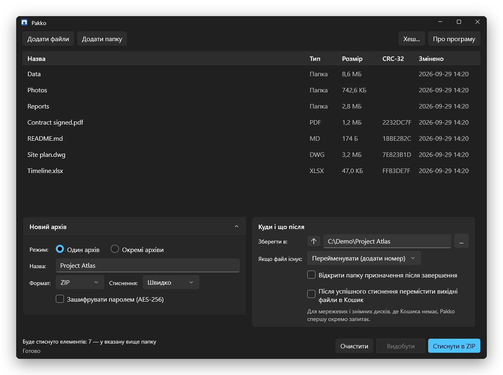

  

<h1 align="center">Pakko — архіватор для Windows</h1>

ZIP — власними засобами .NET (<code>System.IO.Compression</code>); tar, 7z, RAR та інші — вбудованим у Windows <code>tar.exe</code>, у пісочниці.

<strong>Без 7-Zip. Без WinRAR. Без стороннього коду стиснення.</strong>

  
  
  
  
  

  <a href="https://pakkoapp-oss.github.io/pakko/uk/">🌐 Сайт проєкту</a> ·
  <a href="https://apps.microsoft.com/detail/9p5mw010d8pr">🛒 Отримати в Microsoft Store</a> ·
  <a href="https://ko-fi.com/pakko_app">☕ Підтримати проєкт на Ko-fi</a> ·
  <a href="README.md">🇬🇧 English</a>

---

## Встановлення

Потрібна Windows 10 версії 2004 (збірка 19041) або новіша чи Windows 11, x64 або ARM64.

- **Microsoft Store** (рекомендовано): https://apps.microsoft.com/detail/9p5mw010d8pr або
  `winget install 9P5MW010D8PR --source msstore`. Оновлення приходять через Store, а разом із
  застосунком з'являється команда `pakko` у будь-якому терміналі.
- **GitHub Releases**: кожен тег версії публікує MSIX і окремий zip командного рядка `pakko` для
  кожної архітектури, з файлом `SHA256SUMS`, переліком компонентів (SBOM) і атестаціями збірки:
  [релізи](https://github.com/pakkoapp-oss/pakko/releases). MSIX підписано власним сертифікатом
  розробника проєкту, і Windows спершу попросить додати його до довірених (публічно довірений
  сертифікат заплановано, див. [`docs/SIGNING.md`](docs/SIGNING.md)).
- **winget (лише командний рядок)**: zip `pakko` подано до каталогу winget, він чекає на
  модератора; доти беріть zip із GitHub Releases. Див. [`docs/CLI.md`](docs/CLI.md), розділ
  «Distribution».

---

## Що вміє

### Формати

| Формат | Стан | Чим |
|--------|------|-----|
| ZIP | ✅ читання і створення | `System.IO.Compression` (.NET) |
| ZIP із паролем | ✅ читання (ZipCrypto, WinZip AES) і створення (лише AES-256) | `System.IO.Compression` + криптографія .NET |
| tar, tar.gz, tar.bz2, tar.xz, tar.zst, tar.lzma | ✅ читання і створення; окремі файли `.gz`/`.bz2`/`.xz` теж (v1.9.0) | `tar.exe` |
| 7z | ✅ читання; створення без пароля там, де `tar.exe` уміє записувати 7z | `tar.exe` |
| RAR | ✅ лише читання — libarchive не вміє записувати RAR | `tar.exe` |
| Зашифровані 7z/RAR | ❌ розпізнаються й відхиляються зі зрозумілим повідомленням | — |
| ISO 9660, CAB, cpio, ar (`.deb`), `.Z`, lzip | Буде у v1.10.0 (ще не випущено): лише читання, там, де встановлений `tar.exe` читає кожен із них; образ UDF (більшість інсталяційних ISO Windows) відхиляється з поясненням | `tar.exe` |

`tar.exe` входить до Windows, і які формати він читає, залежить від збірки Windows. Актуальна
Windows 11 читає все перелічене; `tar.exe` у Windows 10 зібрано лише з zlib, і він читає tar і
tar.gz. Pakko питає встановлений `tar.exe` і пропонує лише те, що той уміє (`pakko i` показує
перелік). Читання відбувається в пісочниці AppContainer без доступу до мережі.

### У Провіднику

- **Контекстне меню** — «Відкрити», «Видобути до поточної папки», «Видобути до папки», «Додати
  до "X.zip"» (а також `X.7z` і `X.tar`), «Стиснути…», «Тестувати архів», «Перевірити на загрози», хеш-суми (CRC-32,
  SHA-256); і в меню Windows 11, і в «Показати додаткові параметри». Кожна команда виконується у
  вікні Pakko з поступом, запитом пароля та діалогом конфлікту.
- **Типи файлів** — подвійне клацання будь-якого архіву, який читає Pakko, відкриває його в
  переглядачі архівів.
- **Позначка Інтернету (Mark of the Web)** — файли, видобуті із завантаженого архіву, за
  замовчуванням зберігають його `Zone.Identifier`, тож Office відкриває їхні макроси в режимі
  захищеного перегляду (7-Zip за замовчуванням цього не робить). Для одного архіву, якому ви
  довіряєте, позначку можна не переносити, якщо групова політика не вирішує інакше.

### У застосунку

- **Архівування** — один архів або окремий на кожен елемент, ZIP, 7z чи будь-який формат tar, із
  вибором рівня стиснення.
- **Видобування** — розумна логіка папок, «Запитати / Замінити / Перейменувати / Пропустити» для
  кожного конфлікту; дати, збережені в архіві, лишаються.
- **Переглядач архівів** — перегляд папок архіву, видобування вибраного або всього, попередній
  перегляд зображення чи тексту без ручного видобування, підйом вище кореня архіву в реальну
  файлову систему.
- **Тест** — для кожного формату: у 7z, а також tar.bz2, tar.xz і tar.zst, записаних із
  контрольною сумою, перевіряється вміст; tar, tar.gz, tar.lzma і RAR проходять перевірку
  структури, про що Pakko й повідомляє.
- **Перевірка на загрози** — вміст архіву передається встановленому антивірусу через AMSI Windows,
  зокрема записи ZIP із паролем.
- **Дані для відновлення (PAR2)** — стандартні файли PAR 2.0 поруч із новим архівом (5, 10 або
  20 %); перевірка і відновлення в новий файл. par2cmdline і MultiPar читають набори Pakko, а Pakko
  — їхні.
- Значок у системному лотку, 37 мов (за мовою Windows, інакше англійська), журнал у
  `%LocalAppData%\Pakko\logs\pakko.log`.

### У командному рядку

`pakko` має команди, знайомі з 7-Zip: `a`, `x`, `l`, `t`, `i`, `h` (хеш-суми) і `r` (відновлення за
PAR2), з ключами на кшталт `-p`, `-ao`, `-sdel`, `-rr`. Команда з'являється разом зі встановленням
зі Store або постачається окремим zip, що працює без застосунку. Повний довідник:
[`docs/CLI.md`](docs/CLI.md) (англійською).

### Для адміністраторів

Групові політики (ADMX) дають змогу на всіх машинах вимкнути читання tar-родини, заблокувати
формати, примусово зберігати позначку Інтернету тощо: [`docs/POLICIES.md`](docs/POLICIES.md).

---

## Чого Pakko не робить

- Не створює архівів RAR (вільного засобу запису RAR немає) і 7z із паролем.
- Не працює з розділеними чи багатотомними архівами (`.001`, `.z01`).
- Не змінює архів на місці (`u`, `d`, `rn` у 7-Zip): Pakko записує новий архів.
- Не видобуває «пласко», без папок (`e` у 7-Zip).
- Не монтує образи дисків: ISO і VHD/VHDX відкриває сама Windows.

Повний перелік із причиною для кожного формату: [`docs/SPEC.md`](docs/SPEC.md) (англійською).

---

## Довіра і безпека

Код стиснення в Pakko — це код середовища .NET і самої Windows: жодного 7-Zip, WinRAR чи іншого
стороннього коду стиснення, жодної телеметрії і жодних власних мережевих запитів. Чому це важливо,
історія CVE, пісочниця, позначка Інтернету й усі залишкові ризики: [`SECURITY.md`](SECURITY.md)
(англійською).

Видобування захищене від виходу за межі папки (zip slip), архівних бомб (стиснення понад 1000:1
видобувається лише після вашого підтвердження і якщо на диску є місце), зарезервованих імен,
альтернативних потоків даних і точок повторного аналізу, а скасування не лишає частково записаних
файлів. Схему URI не зареєстровано, тож вебсторінка не може запустити Pakko посиланням.

Кожен реліз містить `SHA256SUMS`, CycloneDX SBOM і атестацію походження збірки, яку можна перевірити
командою `gh attestation verify` (див. `SECURITY.md`, «Component List»). Підпис коду:
[`docs/SIGNING.md`](docs/SIGNING.md).

---

## Стан

Останній реліз: v1.9.0. Історія релізів: [`CHANGELOG.md`](CHANGELOG.md) (англійською). План
розвитку: [`docs/SPEC.md`](docs/SPEC.md), «Future Roadmap». Відкриті задачі:
[`docs/TASKS.md`](docs/TASKS.md).

**Відома проблема:** контекстне меню може блимнути під час першого клацання правою кнопкою в щойно
відкритому вікні Провідника. Це власний кеш команд Провідника, а не помилка Pakko.

---

## Участь у розробці

Збірка, розгортання й тести: [`CONTRIBUTING.md`](CONTRIBUTING.md) і
[`scripts/README.md`](scripts/README.md) (англійською). Технології: C# 14 на .NET 10 LTS, WinUI 3 і
Windows App SDK, Native AOT; меню Провідника — DLL на C++ з `IExplorerCommand`.

---

## Документи

- [Документація для розробників / API](https://pakkoapp-oss.github.io/pakko/dev/) — згенерований
  сайт: архітектура, конвенції, довідник CLI та API-довідник, зібраний з XML doc-коментарів
  `Archiver.Core` (англійською)
- [Журнал змін](CHANGELOG.md) — історія релізів (англійською)
- [Політика безпеки](SECURITY.md) — модель загроз, таблиці CVE, заходи захисту (англійською)
- [Політика приватності](docs/privacy.html)
- [Політика підпису коду](docs/SIGNING.md)
- [Довідник групових політик / ADMX](docs/POLICIES.md)
- [Довідник команд CLI](docs/CLI.md)
- [Гід для учасників розробки](CONTRIBUTING.md)
- [Кодекс поведінки](CODE_OF_CONDUCT.md)
- [Ліцензія (Apache 2.0)](LICENSE)
